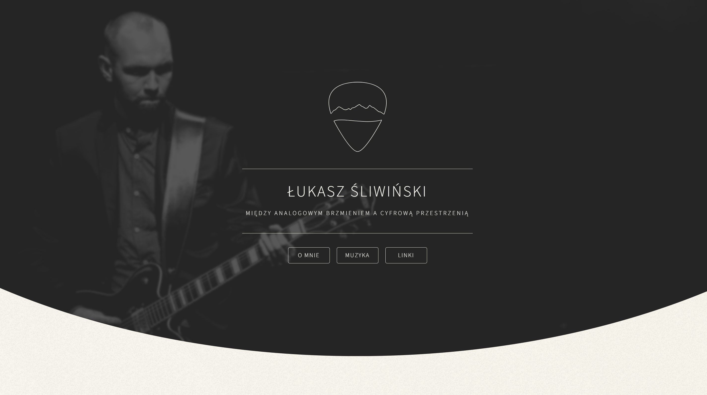

# Łukasz Śliwiński – Music Website

**[www.lukaszsliwinski.pl](https://www.lukaszsliwinski.pl)**

## About the project

The official website of my solo music project, built entirely by me from start to finish: from concept, through implementation and content, to production deployment. The interface was created without UI component libraries: the guitar pick-shaped links are built in pure CSS, and scrolling between sections uses a custom animation. The main content is kept separate from the components and gathered in a single file, which makes it easy to edit. The site is responsive and, among other things, uses a separate background image on mobile devices.

## Technologies

**Frontend**

- **Next.js 16 (App Router)** – static prerendering, plus image and font optimization
- **React 19 and TypeScript** – typed components and data
- **Tailwind CSS 4** – styling and responsiveness, with a theme based on CSS variables
- **Motion** – intro animation and animated elements that appear on scroll
- **Inline SVG and Font Awesome** – icons that inherit theme colors, and music service icons
- **SoundCloud Widget** – player embedded in the music section

**Deployment**

- **Docker** – multi-stage build, Next.js standalone mode, container running without root privileges
- **Traefik** – reverse proxy with domain routing, TLS certificate and HSTS header
